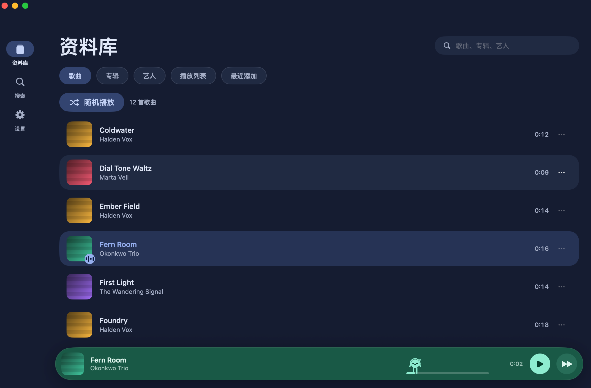
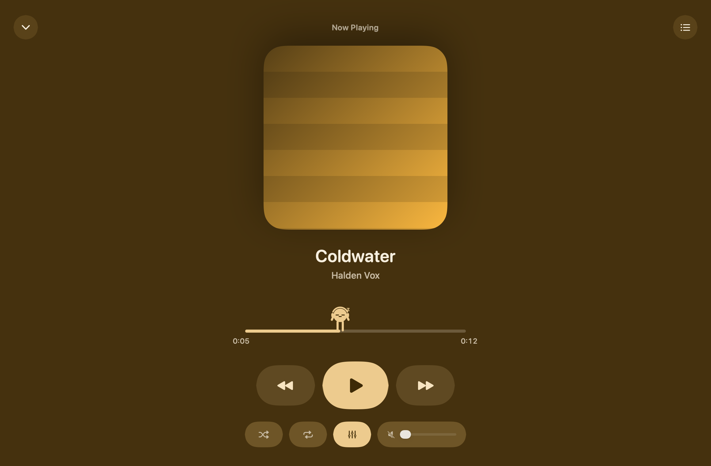
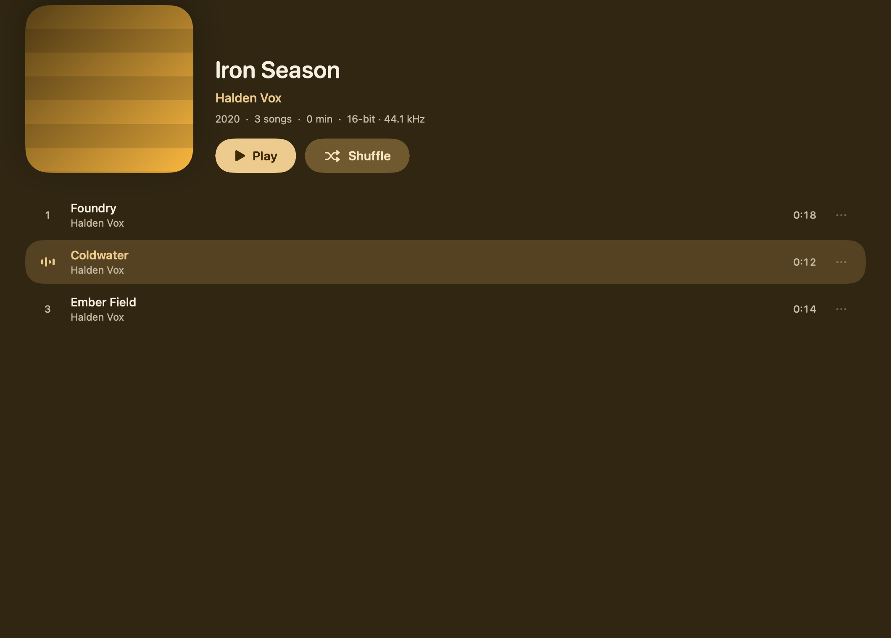
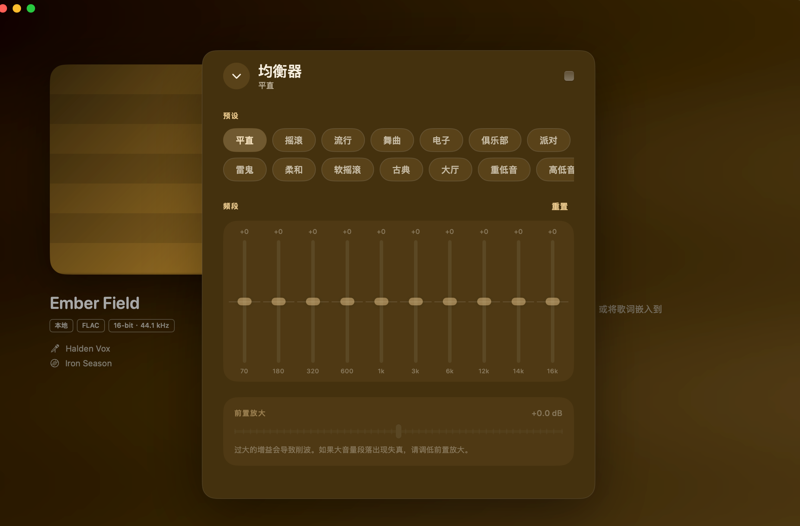
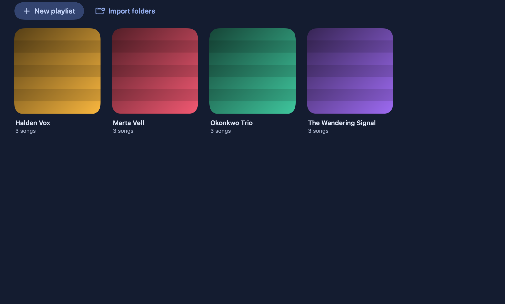
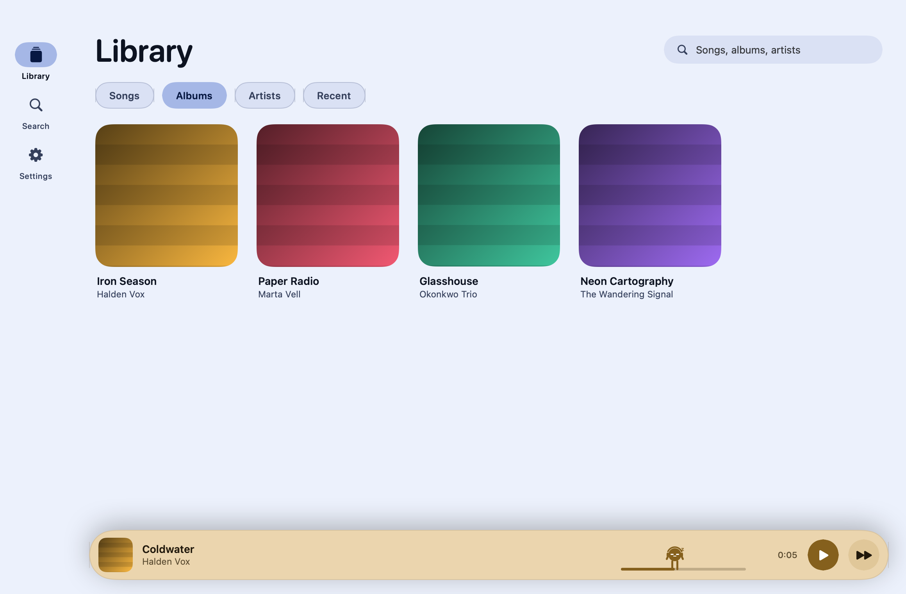

# Aria

A local music player for macOS and iOS. One SwiftUI codebase, no accounts, no network, no
streaming — it reads files off your disk and plays them.



## Why

Apple's Music app will not touch FLAC, and most alternatives either transcode your library,
ask you to sign in, or phone home. Aria does none of that: it walks a folder, parses the
FLAC headers itself, and plays the files where they sit.

## What it does

- **Plays FLAC, ALAC, MP3, AAC, WAV, AIFF and CAF** through `AVAudioEngine`, with seeking,
  shuffle, repeat and a queue. FLAC is decoded by AVFoundation too; the difference is that
  Aria reads its tags itself, because AVFoundation will not expose Vorbis comments.
- **Reads its own metadata.** `AVFoundation` decodes FLAC audio but won't expose Vorbis
  comments, so Aria parses the metadata blocks directly — titles, artists, album, track
  numbers, and embedded cover art. MP3 (ID3), M4A (iTunes atoms), WAV and AIFF tags come
  from AVFoundation, which also tells ALAC from AAC so a lossy file can never be labelled
  lossless.
- **Themes itself from the artwork.** Each album's cover is sampled and a Material-style
  tonal palette is generated from its dominant hue, so the player re-tints per record.
- **Playlists** you build yourself, or generated in one click from your existing folder
  layout. Membership is stored by relative path *and* by the title/album tags inside each
  file, so a playlist made on a Mac still resolves on a phone where the paths differ and
  the filenames were rewritten in transit.
- **Ten-band equalizer** with Winamp's 18 original presets.
- **Duplicate detection.** Downloaders often leave a second copy beside the first; matching
  on title, artist, album and duration collapses them while keeping different songs that
  merely share a title.
- **A mascot** who walks the progress bar, dances on the beat, and falls asleep when you
  pause. He is also the scrubber — drag him to seek.
- **System integration**: media keys, Control Center, lock screen, and background audio.

## New features in this version · 本版本新增特性

**English**

- **In-app language switching (English / 简体中文).** A Language section in Settings on
  both platforms; the switch takes effect immediately and is remembered. All interface
  strings — navigation, library, player, equalizer, audio chain, output modes, menus —
  are localized, following Apple's Simplified Chinese conventions.
- **Bit-perfect audio chain inspector.** A Source → Processing → Output read-out showing
  the actual signal path: sample rate matching, resampling, software gain, EQ state,
  channel layout, and a colour-coded quality verdict (BIT-PERFECT / UNVERIFIED / STANDARD
  / PROCESSED / LOSSY LINK) with concrete, actionable improvement notes.
- **Exclusive output mode on macOS.** Aria can take hog-mode exclusive access to the
  output device and clock it to each track's own sample rate, so nothing is resampled.
  Shared / Exclusive modes, an output device picker with per-device capability badges
  (CD quality / Hi-Res / Ultra Hi-Res), and quick device/mode switching inside the
  audio-chain panel.
- **Synced lyrics.** Reads `.lrc` sidecar files and lyrics embedded in file tags; a
  scrolling lyrics pane beside the cover, and a full-screen desktop stage with the lyrics
  and a blurred artwork backdrop on macOS.
- **Decibel software volume.** A fine-grained volume on top of the system volume, down
  to −50 dB for when iOS's lowest step is still too loud.
- **A local folder browser on iOS.** Picks music folders without leaving the process, so
  it keeps working under LiveContainer and SideStore-signed installs where the system
  document picker silently fails.

**中文**

- **应用内语言切换（English / 简体中文）。** 两端设置中新增语言选项，切换即时生效并自动记忆。全部界面文案——导航、资料库、播放器、均衡器、音频链路、输出模式、应用菜单——均已本地化，译文遵循 Apple 简体中文惯例。
- **无损直通（bit-perfect）音频链路检查器。** 以「音源 → 处理 → 输出」呈现真实信号路径：采样率匹配、重采样、软件增益、均衡器状态、声道布局，并给出颜色标注的音质判定（无损直通 / 未确认 / 标准 / 已处理 / 有损连接）与具体可操作的改进建议。
- **macOS 独占输出模式。** Aria 可独占访问输出设备（hog 模式）并将时钟切换到每首曲目自身的采样率，输出过程不做任何重采样。支持共享/独占两种模式、带能力徽章（CD 音质 / 高清 / 超高清）的输出设备选择，以及音频链路面板内的设备与模式快捷切换。
- **歌词显示。** 支持与音频同名的 `.lrc` 歌词文件和内嵌在文件标签中的歌词；封面旁有滚动歌词栏，macOS 端还有带模糊封面背景的全屏播放页与桌面歌词。
- **分贝级软件音量。** 在系统音量之上提供更细粒度的音量控制，最低可到 −50 dB，解决 iOS 最低一档仍然太响的问题。
- **iOS 本地文件夹浏览器。** 在应用进程内完成文件夹选择，不依赖系统文件选择器，因此在 LiveContainer 与 SideStore 签名安装等系统选择器失效的场景下依然可用。

## Screenshots

| Now Playing | Album |
|---|---|
|  |  |

| Equalizer | Playlists |
|---|---|
|  |  |



*Screenshots use the synthetic demo library generated by
`Tools/make-demo-library.py` — the audio and cover art are procedurally generated, not
anyone's actual music.*

## Quick start

**macOS** — needs Xcode or the Command Line Tools:

```bash
./build.sh --run
```

That builds `build/Aria.app` and opens it. By default it scans `~/Music`; point it
somewhere else in Settings.

**Try it without a library** — generate 12 tracks of synthetic audio with proper tags and
artwork:

```bash
python3 Tools/make-demo-library.py ~/Music/AriaDemo
```

**iOS** — see [docs/BUILDING.md](docs/BUILDING.md) for the full walkthrough including
signing, Developer Mode, and getting music onto the device. The short version:

```bash
open Aria.xcodeproj     # set your Team under Signing & Capabilities, then ⌘R
```

## Requirements

| | |
|---|---|
| macOS | 14 Sonoma or later |
| iOS | 17 or later |
| Build | Xcode 16+ (iOS), or Command Line Tools alone (macOS) |
| Dependencies | none |

There are no third-party packages. Everything is Foundation, AVFoundation, SwiftUI and
CoreGraphics.

## How it's organised

```
Sources/Aria/
  Models/      FLACMetadata.swift   the FLAC metadata block parser
               AudioMetadata.swift  tags + stream format for every other container
               AudioFormat.swift    which codecs Aria can open, and which are lossless
               Track.swift          track/album/artist model
  Library/     LibraryStore.swift   folder scanning, de-duplication, cache
               PlaylistStore.swift  playlists and their persistence
               ArtworkCache.swift   lazy cover-art decoding
               ArtworkPalette.swift dominant-colour extraction
  Player/      AudioPlayer.swift    AVAudioEngine graph, queue, transport
               Equalizer.swift      band definitions + presets
               NowPlayingController.swift   media keys, lock screen
  Platform/    Platform.swift       the only file that knows about AppKit vs UIKit
  Views/       …                    shared SwiftUI, plus Views/iOS for the phone layout
```

`Platform.swift` is the entire platform-abstraction layer — everything else is shared
between macOS and iOS. See [docs/ARCHITECTURE.md](docs/ARCHITECTURE.md) for how the
metadata parsers, palette extraction and audio graph actually work, including the parts
that are easy to get wrong.

## Contributing

Issues and pull requests are welcome. A few things worth knowing:

- The macOS build (`./build.sh`) is the fastest way to check a change compiles.
- `xcrun --sdk iphonesimulator swiftc -typecheck -target arm64-apple-ios17.0-simulator
  -parse-as-library $(find Sources/Aria -name '*.swift')` type-checks the iOS side without
  a full build.
- Use the demo library rather than committing audio files.

## Credits and licence

**Origin / 项目来源**：This project is based on the original open-source project
**[Aria](https://github.com/aaryann123/aria-player)** — a local, lossless-first music
player for macOS and iOS, released under the MIT License. The features listed above were
added on top of that original codebase.
**本项目基于原始开源项目 Aria（macOS / iOS 本地无损音乐播放器，MIT 许可证）二次开发，
上述新增特性均在其原始代码基础上实现。**

Aria is MIT licensed — see [LICENSE](LICENSE).

The interface follows **Material 3 Expressive**, Google's design language. The
implementation here is original SwiftUI; no Material code is included.

The equalizer presets are **Winamp's original 18**, sourced from
[schollz/Winamp-Original-Presets](https://github.com/schollz/Winamp-Original-Presets) and
converted from Winamp's 0–63 storage to decibels. The band centre frequencies are Winamp's
too, so the curves apply exactly as designed. Preset gain values are factual data rather
than creative work, but the provenance is noted so you can judge for yourself.
