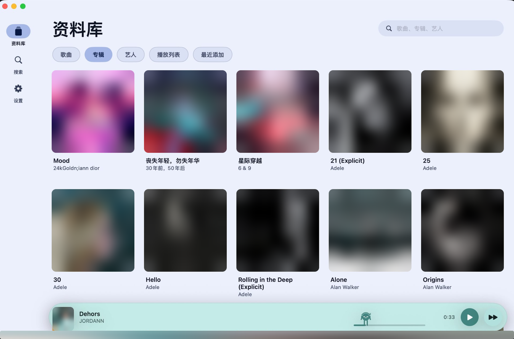
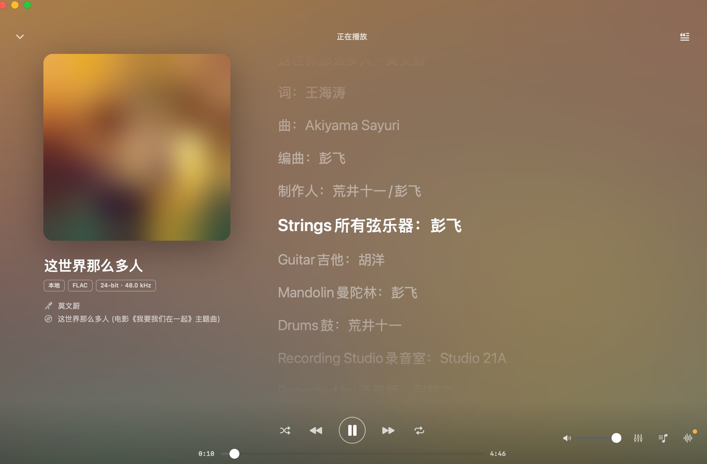
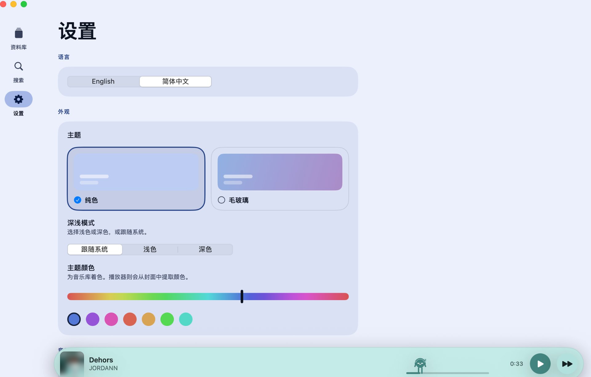
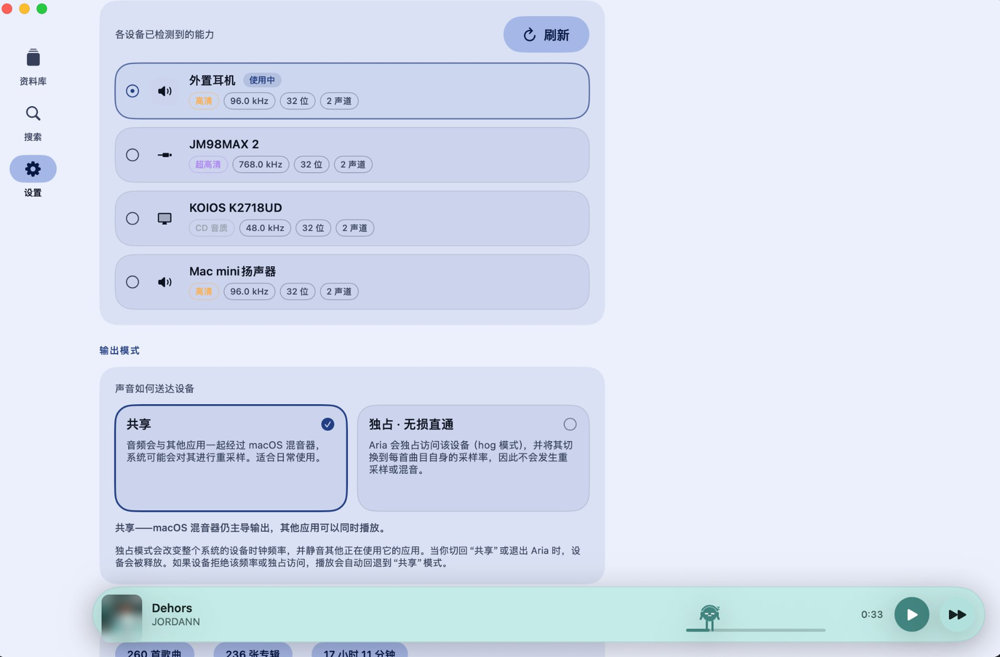
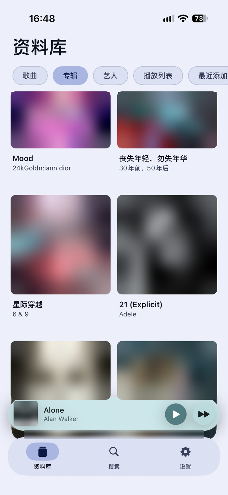
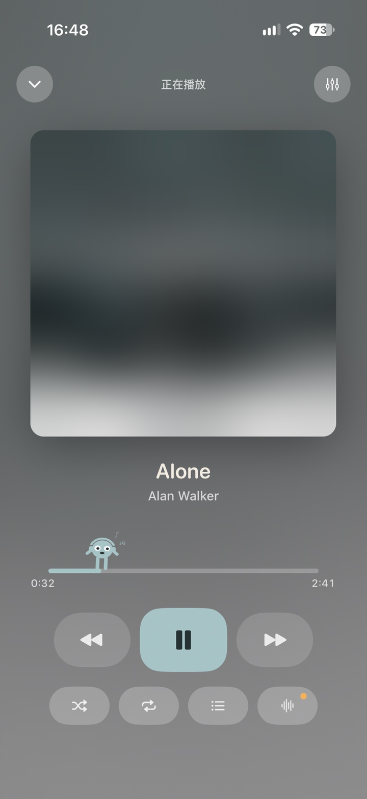
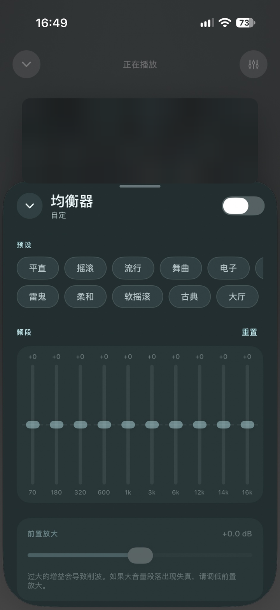

# Aria

**English** · [简体中文](#简体中文)

[](https://github.com/cheneyzhouzhou/aria-player/releases/latest)
[](LICENSE)


A local, lossless-first music player for macOS and iOS. One SwiftUI codebase, no account,
no streaming, no network code at all — point it at a folder and it plays the files where
they sit.



---

## English

### Why it exists

Apple's Music app will not open FLAC, and most alternatives either transcode your library,
ask you to sign in, or phone home. Aria does none of that: it walks a folder, reads the
metadata itself, and plays the files untouched.

### Highlights

**Sound you can verify**

- **A signal-path inspector, not a marketing badge.** Source → Processing → Output shows
  sample-rate matching, resampling, software gain, EQ state and channel layout, then gives
  a colour-coded verdict — BIT-PERFECT, UNVERIFIED, STANDARD, PROCESSED or LOSSY LINK —
  with concrete notes on what is degrading the chain.
- **Exclusive output on macOS.** Hog-mode access to the output device, clocked to each
  track's own sample rate, so nothing is resampled on the way out. Shared / Exclusive
  modes and a device picker with per-device capability badges (CD / Hi-Res / Ultra Hi-Res).
- **10-band EQ with Winamp's original 18 presets.** Band centres are Winamp's own
  (70 Hz – 16 kHz) and the gains are converted from its 0–63 storage, so the curves apply
  exactly as designed.
- **−50 dB software volume.** Fine-grained gain under the system volume, for in-ears on a
  phone whose lowest hardware step is still too loud.

**Your library, read properly**

- **FLAC, ALAC, WAV, AIFF, CAF, MP3 and AAC, played in place.** Nothing is copied,
  transcoded or moved; the folder stays yours.
- **Aria parses FLAC metadata by hand.** AVFoundation decodes the audio but hides Vorbis
  comments, so the parser reads titles, artists, albums, track numbers and embedded cover
  art directly from the metadata blocks. MP3 (ID3) and M4A (iTunes atoms) come from
  AVFoundation — which also tells ALAC from AAC, so a lossy file can never be labelled
  lossless.
- **Duplicates collapse; namesakes don't.** Matching on title, artist, album *and* duration
  removes the second copy a downloader left behind, while keeping genuinely different songs
  that happen to share a title.
- **Playlists that survive the move.** Membership is stored by relative path *and* by the
  tag values inside each file, so a playlist built on the Mac still resolves on a phone
  where the paths differ.

**A player that looks like your music**

- **Three themes: Solid, Morandi, Frosted glass.** Solid follows the album's hue; Morandi
  is a quiet, dusty palette; frosted glass blurs what sits behind every panel.
- **A transparency dial that reaches both ends.** In the glass theme, Settings › Appearance
  exposes 0–100%: at 0% panels are fully opaque, at 100% the frost, blur, rim, border and
  shadow are gone entirely. It applies to every surface — rail, page, player bar, nav bar,
  and the equalizer / audio-chain / queue popups.
- **The window re-tints per album.** Each cover is sampled and a Material-style tonal
  palette is generated from its dominant hue, so the whole player changes colour with the
  record.
- **A mascot who is also the scrubber.** He walks the progress bar, dances on the beat and
  falls asleep when you pause — drag him to seek.

**Fits the operating system**

- **macOS**: a menu-bar player built from two fixed-width items (the title can be hidden),
  so the controls never jump when tracks change; output-device picker; universal binary for
  Apple Silicon and Intel.
- **iOS**: Apple Music library access for songs you imported, synced or bought (DRM-free
  only — protected tracks are skipped, never copied), an in-process folder browser that
  keeps working under LiveContainer / SideStore installs, background audio, lock screen,
  Control Center and media keys.
- **Synced lyrics**: a `.lrc` file beside the track or lyrics embedded in its tags, shown in
  a scrolling pane — plus a full-screen stage with a blurred artwork backdrop on macOS.

**Private by construction, bilingual by default**

- **No network code.** Not a single request: no accounts, no telemetry, no analytics, no
  update pings. Your library never leaves the machine.
- **English and 简体中文**, switchable in Settings and remembered across launches. On macOS
  the system menus, folder panels and dialog buttons follow the app's language too.

### Screenshots

| macOS — library | macOS — now playing |
|---|---|
|  |  |

| macOS — appearance | macOS — output & exclusive mode |
|---|---|
|  |  |

| iOS — library | iOS — now playing | iOS — equalizer |
|---|---|---|
|  |  |  |

*Screenshots use the frosted-glass theme with the interface in Simplified Chinese. Album
covers are blurred, so no artwork is reproduced here.*

### Download

Grab the latest build from **[Releases](https://github.com/cheneyzhouzhou/aria-player/releases/latest)**:

| Asset | What it is |
|---|---|
| iOS `.ipa` | iOS 17+, unsigned — re-sign with Sideloadly / AltStore |
| `…-macOS.zip` | macOS 14+, Apple Silicon |
| `…-macOS-universal.zip` | macOS 14+, Apple Silicon + Intel |

- **iOS**: sideload the IPA. A free Apple ID signature lasts 7 days; re-sign when it expires.
- **macOS**: unzip and drag `Aria.app` into Applications. If Gatekeeper blocks the first
  launch, right-click → Open.

### Build from source

**macOS** — needs Xcode or the Command Line Tools:

```bash
./build.sh --run          # builds build/Aria.app and opens it
./build-ipa.sh            # unsigned iOS IPA, versioned from ./VERSION
./build-ios-sim.sh --run  # installs onto a booted simulator
```

**iOS on a device** — open `Aria.xcodeproj`, set your Team under *Signing & Capabilities*,
then ⌘R. [docs/BUILDING.md](docs/BUILDING.md) covers signing, Developer Mode and getting
music onto the phone.

Want a library to try it with? `python3 Tools/make-demo-library.py ~/Music/AriaDemo`
generates 12 synthetic tracks with proper tags and artwork.

### Requirements

| | |
|---|---|
| macOS | 14 Sonoma or later |
| iOS | 17 or later |
| Build | Xcode 16+ (iOS), or Command Line Tools alone (macOS) |
| Dependencies | none — Foundation, AVFoundation, SwiftUI, CoreGraphics only |

### Documentation

- [docs/ARCHITECTURE.md](docs/ARCHITECTURE.md) — metadata parsers, palette extraction, the
  audio graph, and the parts that are easy to get wrong.
- [docs/BUILDING.md](docs/BUILDING.md) — full iOS signing and device walkthrough.
- [release-notes/](release-notes) — what changed in each release.

`Platform.swift` is the entire platform-abstraction layer; everything else is shared
between macOS and iOS.

### Credits and licence

Aria is based on the original open-source project
**[Aria](https://github.com/aaryann123/aria-player)** (MIT), a local lossless-first player
for macOS and iOS. The features above were built on top of that codebase.

MIT licensed — see [LICENSE](LICENSE). The interface follows **Material 3 Expressive**;
the implementation is original SwiftUI, with no Material code included. The equalizer
presets are Winamp's original 18, sourced from
[schollz/Winamp-Original-Presets](https://github.com/schollz/Winamp-Original-Presets).

---

## 简体中文

### 为什么做它

苹果「音乐」App 打不开 FLAC，而多数替代品要么转码你的曲库，要么要求登录，要么偷偷联网。
Aria 都不做：它遍历一个文件夹，自己解析元数据，然后把文件原样播放。

### 特色

**音质是可以验证的**

- **看得见的信号路径。** 「音源 → 处理 → 输出」逐段列出采样率匹配、重采样、软件增益、
  均衡器状态与声道布局，并给出颜色标注的判定——无损直通 / 未确认 / 标准 / 已处理 /
  有损连接，附具体可操作的改进建议，而不是一个营销标签。
- **macOS 独占输出。** 以 hog 模式独占输出设备，并把时钟切换到每首曲目自身的采样率，
  输出过程不做任何重采样；提供共享 / 独占两种模式，以及带能力徽章（CD 音质 / 高清 /
  超高清）的设备选择。
- **10 段均衡器 + Winamp 原始 18 个预设。** 频段中心频率就是 Winamp 的
  70 Hz – 16 kHz，增益由其 0–63 存储换算为分贝，曲线与设计原样一致。
- **−50 dB 软件音量。** 在系统音量之下再提供一层细粒度增益，专治手机上最低一档仍然太响。

**把曲库读对**

- **FLAC / ALAC / WAV / AIFF / CAF / MP3 / AAC，原地播放。** 不复制、不转码、不搬动文件，
  文件夹还是你的文件夹。
- **FLAC 元数据自己解析。** AVFoundation 能解码音频却不暴露 Vorbis 注释，所以标题、艺人、
  专辑、音轨号与内嵌封面都由 Aria 直接读元数据块；MP3（ID3）与 M4A（iTunes atoms）走
  AVFoundation，并据此区分 ALAC 与 AAC —— 有损文件永远不会被标成无损。
- **重复曲目合并，同名歌曲不误伤。** 以标题 + 艺人 + 专辑 + 时长四项匹配，清掉下载器留下的
  副本，同时保留确实不同、只是同名的歌。
- **歌单可以跨设备。** 成员同时按相对路径和文件内的标签记录，在 Mac 上建的歌单，到手机上
  路径变了也照样能还原。

**播放器应该长得像你的音乐**

- **三套主题：纯色、莫兰迪、毛玻璃。** 纯色跟随封面色相，莫兰迪是低饱和的灰调，
  毛玻璃把每个面板背后的内容虚化。
- **透明度滑动条，两端都是真的。** 毛玻璃主题下，设置 › 外观 提供 0–100%：0% 面板完全
  不透明，100% 霜层、模糊、高光、描边与阴影全部消失。对所有玻璃面生效——侧栏、页面容器、
  悬浮播放条、底部导航条，以及均衡器 / 音频链 / 播放列表弹窗。
- **整个窗口随专辑换色。** 每张封面都会被取样，并从主色生成 Material 风格的色调阶梯，
  换一张唱片，界面就换一套颜色。
- **吉祥物就是进度条。** 他在进度条上行走、跟着节拍跳舞、暂停时睡着——拖他就是拖动进度。

**融入系统**

- **macOS**：菜单栏播放器由两个固定宽度的项组成（歌名可隐藏），切歌时控件不会跳动；
  输出设备选择；同时提供 Apple Silicon 与 Intel 的通用包。
- **iOS**：可读取「音乐」App 中自行导入 / 同步 / 购买的无 DRM 曲目（受保护曲目直接跳过，
  绝不复制）；进程内文件夹浏览器，在 LiveContainer / SideStore 签名安装下依然可用；
  支持后台播放、锁屏、控制中心与线控。
- **同步歌词**：同目录的 `.lrc` 文件或文件标签里的内嵌歌词，封面旁滚动显示；macOS 还有
  带模糊封面背景的全屏播放页。

**默认私密，默认双语**

- **没有任何网络代码。** 不发一个请求：没有账号、没有遥测、没有统计、没有更新检查。
  曲库不会离开这台设备。
- **English / 简体中文**，在设置里切换并记住选择；macOS 上系统菜单、文件夹选择面板与
  对话框按钮也会跟随 App 语言。

### 界面截图

| macOS — 资料库 | macOS — 播放页 |
|---|---|
|  |  |

| macOS — 外观 | macOS — 输出与独占模式 |
|---|---|
|  |  |

| iOS — 资料库 | iOS — 播放页 | iOS — 均衡器 |
|---|---|---|
|  |  |  |

*截图为毛玻璃主题、简体中文界面；封面已做模糊处理，不展示任何专辑美术。*

### 下载与安装

到 **[Releases](https://github.com/cheneyzhouzhou/aria-player/releases/latest)** 取最新构建：

| 文件 | 说明 |
|---|---|
| iOS `.ipa` | iOS 17+ 未签名包，用 Sideloadly / AltStore 重签 |
| `…-macOS.zip` | macOS 14+，Apple Silicon |
| `…-macOS-universal.zip` | macOS 14+，Apple Silicon + Intel 通用 |

- **iOS**：侧载 IPA；免费 Apple ID 签名 7 天有效，到期重签即可。
- **macOS**：解压后把 `Aria.app` 拖进「应用程序」；首次打开若被拦截，右键 → 打开。

### 从源码构建

**macOS**（需要 Xcode 或 Command Line Tools）：

```bash
./build.sh --run          # 构建 build/Aria.app 并打开
./build-ipa.sh            # 生成未签名 iOS IPA，版本号取自 ./VERSION
./build-ios-sim.sh --run  # 安装到已启动的模拟器
```

**iOS 真机**：打开 `Aria.xcodeproj`，在 *Signing & Capabilities* 里选自己的 Team，然后 ⌘R。
签名、开发者模式、往手机里拷音乐的完整步骤见 [docs/BUILDING.md](docs/BUILDING.md)。

想先随便试听？`python3 Tools/make-demo-library.py ~/Music/AriaDemo` 会生成 12 首带标签与
封面的合成音频。

### 环境要求

| | |
|---|---|
| macOS | 14 Sonoma 及以上 |
| iOS | 17 及以上 |
| 构建 | Xcode 16+（iOS），或仅 Command Line Tools（macOS） |
| 依赖 | 无第三方库，只用 Foundation / AVFoundation / SwiftUI / CoreGraphics |

### 文档

- [docs/ARCHITECTURE.md](docs/ARCHITECTURE.md)：元数据解析、调色板提取、音频图，以及容易
  踩坑的地方。
- [docs/BUILDING.md](docs/BUILDING.md)：iOS 签名与真机安装全流程。
- [release-notes/](release-notes)：每个版本改了什么。

`Platform.swift` 是唯一的平台抽象层，其余代码在 macOS 与 iOS 之间完全共享。

### 来源与许可

本项目基于原始开源项目 **[Aria](https://github.com/aaryann123/aria-player)**
（macOS / iOS 本地无损播放器，MIT 许可证）二次开发，上述特色均在其原始代码基础上实现。

MIT 许可，详见 [LICENSE](LICENSE)。界面遵循 **Material 3 Expressive**，实现为原创 SwiftUI，
不含 Material 代码。均衡器预设为 Winamp 原始 18 组，来源
[schollz/Winamp-Original-Presets](https://github.com/schollz/Winamp-Original-Presets)。
